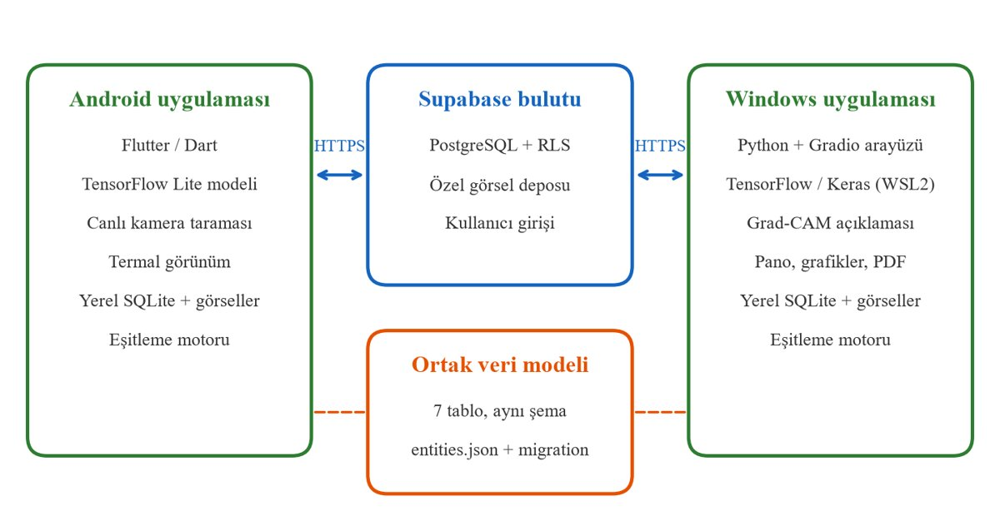
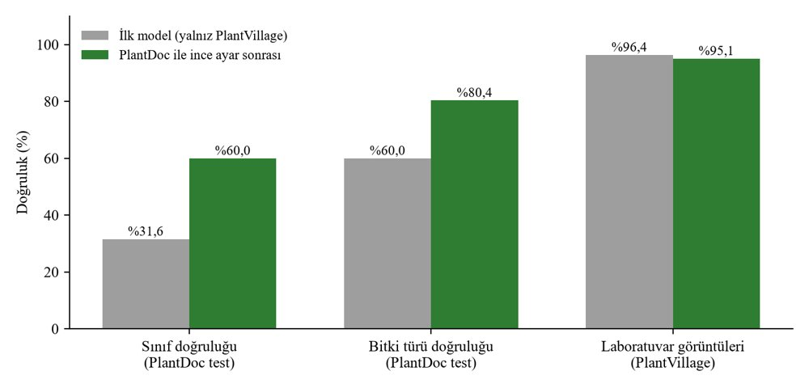
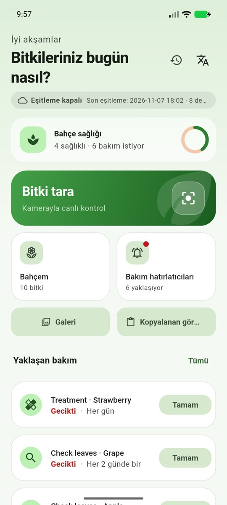
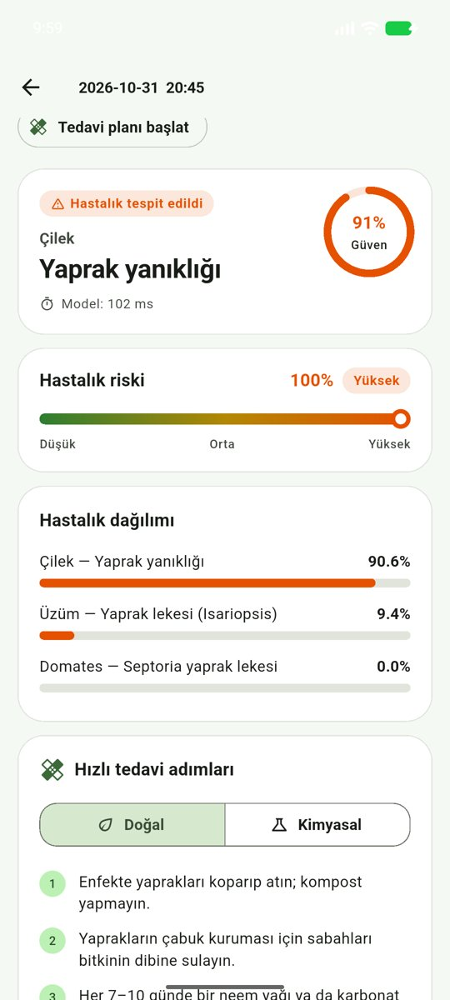
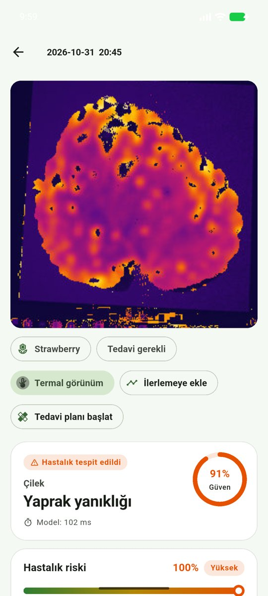
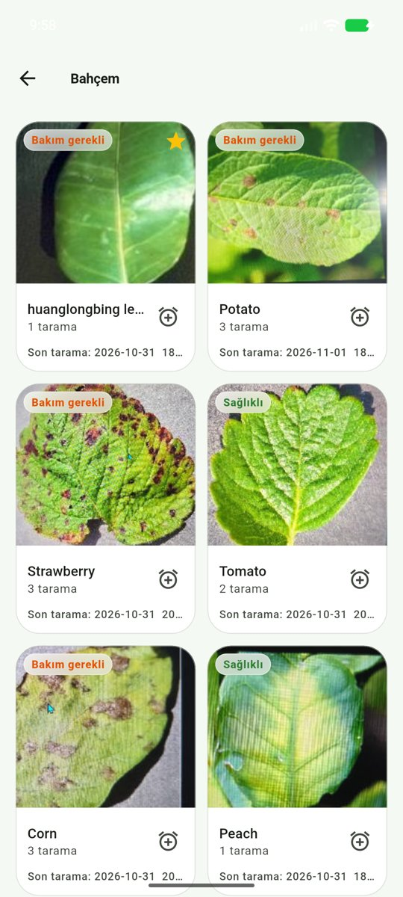
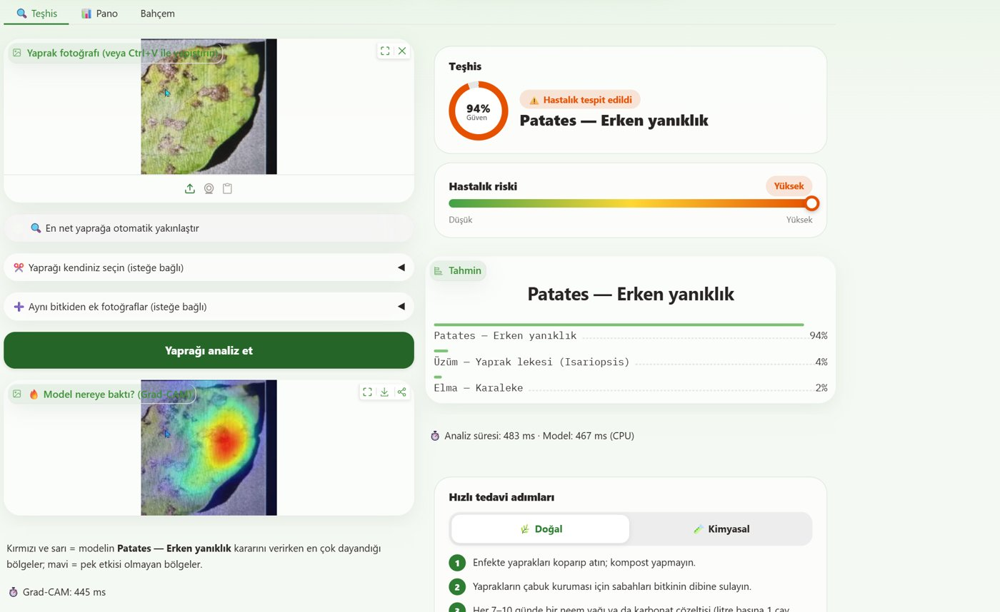
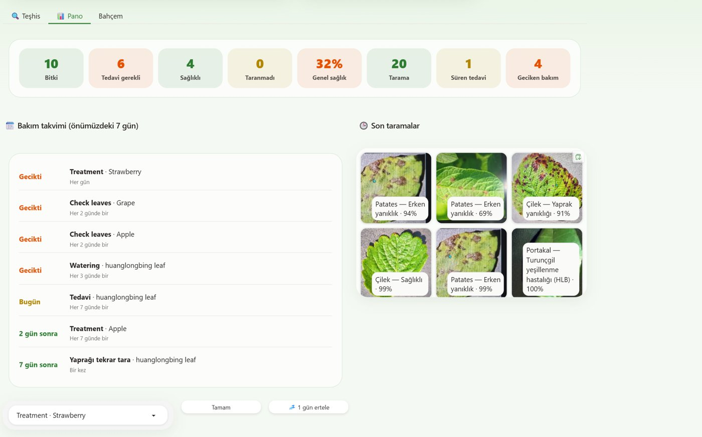
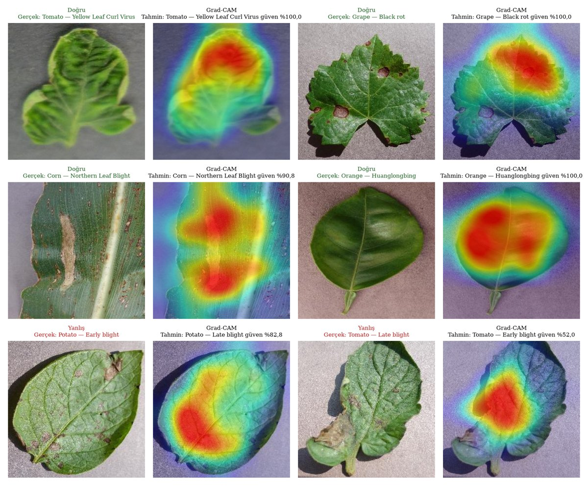

[English](README.md) | **العربية** | [Türkçe](README.tr.md)

# 🌿 طبيب النبات (Bitki Doktoru)

**تشخيص أمراض النبات بالتعلّم العميق وإدارة الحديقة، على Android وWindows، ويعمل بالكامل بدون إنترنت.**

مشروع تخرّج، جامعة سكاريا للعلوم التطبيقية، كلية التكنولوجيا، قسم هندسة الحاسوب (2026).
Ahmad Al Sahmarany · Hasan Ifreitekh. المشرف: Dr. Öğr. Üyesi A F M Suaib Akhter.

> هذه صفحة عرض عامة. الكود المصدري محفوظ في مستودع خاص.

## ماذا يفعل التطبيق

- صوّر ورقة النبات أو ارفع صورتها، فيحدّد التطبيق **نوع النبات والمرض** خلال ثوانٍ (38 صنفاً، 14 نوعاً من النباتات).
- يعمل **على الجهاز نفسه**: TensorFlow Lite على Android وKeras على Windows، ولا يحتاج التشخيص إلى إنترنت.
- يشرح قراره بخرائط حرارية **Grad-CAM** ويقترح خطوات العلاج.
- يدير حديقتك: النباتات، خطط العلاج، تذكيرات ذكية، متابعة التحسّن، إحصائيات، رسوم بيانية وتقارير PDF.
- **مزامنة سحابية** اختيارية بين الهاتف والكمبيوتر (البيانات المحلية أولاً، Supabase مع أمان على مستوى الصفوف).

## النتائج

| | |
|---|---|
| دقة الاختبار (PlantVillage، 8,146 صورة) | **96.99%** (Macro F1 = 0.964) |
| صور حقيقية من الحقل (PlantDoc)، قبل ← بعد الضبط الدقيق | الصنف 31.6% ← **60.0%**، نوع النبات 60.0% ← **80.4%** |
| حجم الموديل (INT8 TFLite) / السرعة | 2.8 MB، حوالي 2.7 ms للصورة على معالج لابتوب |

## لقطات الشاشة

### Android

| الرئيسية | نتيجة الفحص | العرض الحراري | حديقتي |
|---|---|---|---|
|  |  |  |  |

### Windows

### Grad-CAM: أين ينظر الموديل

## التقنيات المستخدمة

MobileNetV2 (التعلّم بالنقل) · TensorFlow / Keras / TensorFlow Lite · OpenCV · Flutter / Dart · Python / Gradio · SQLite · Supabase · C# (مشغّل Windows)

