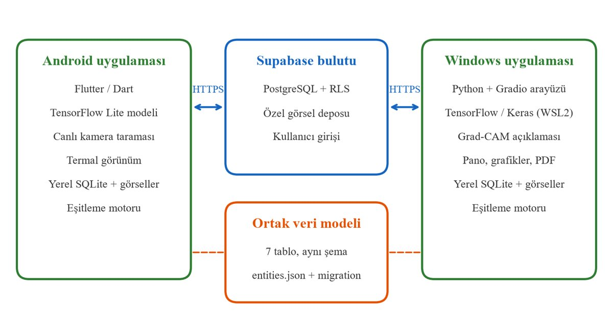
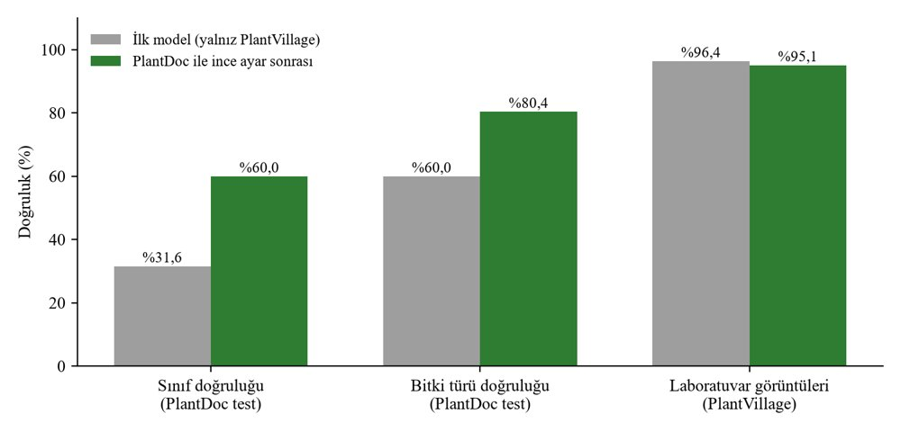
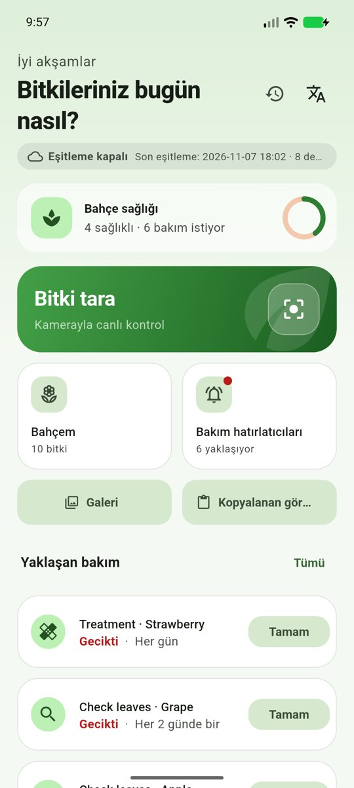
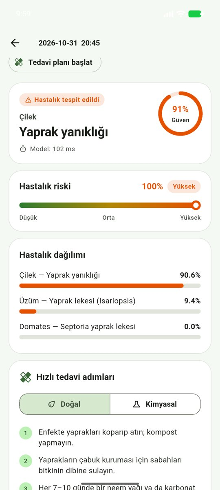
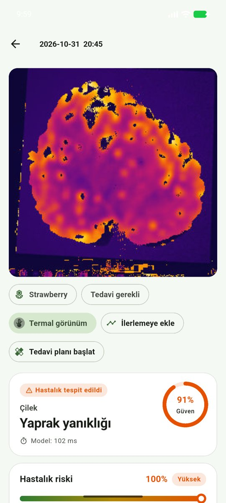
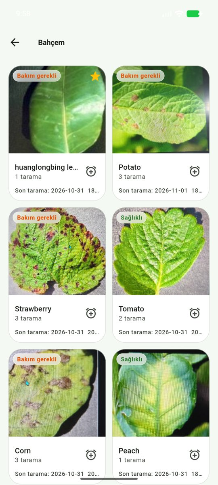
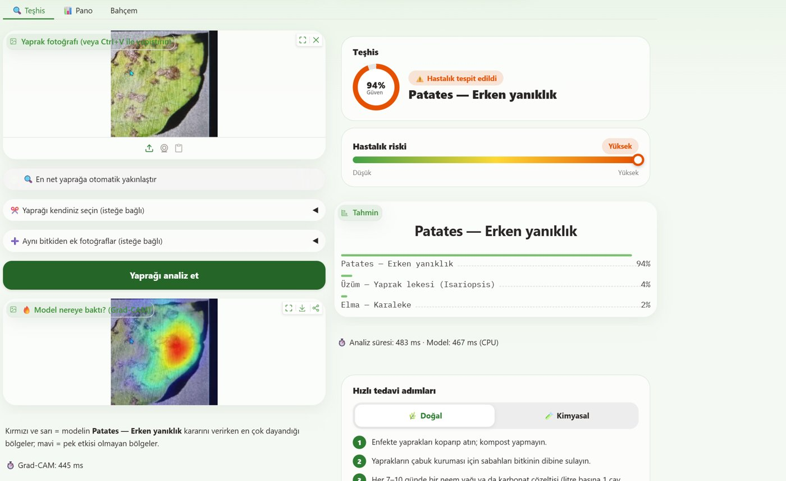
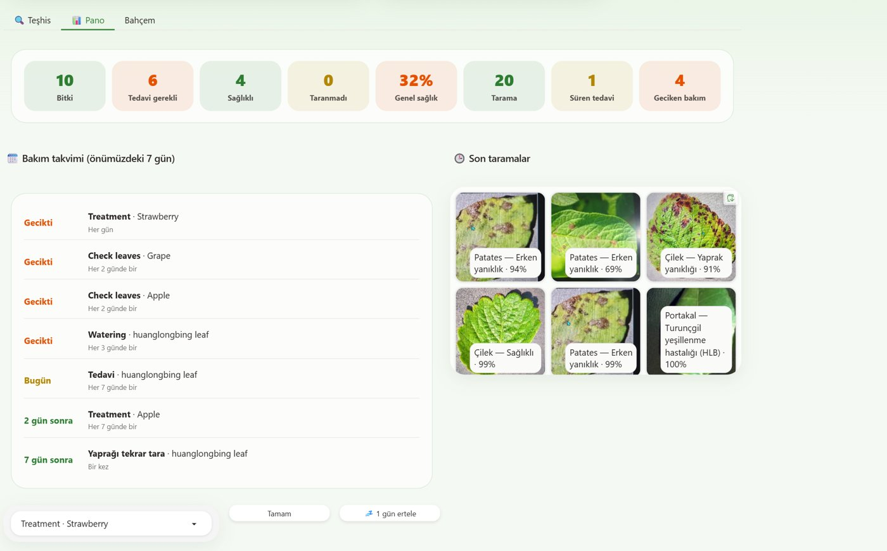
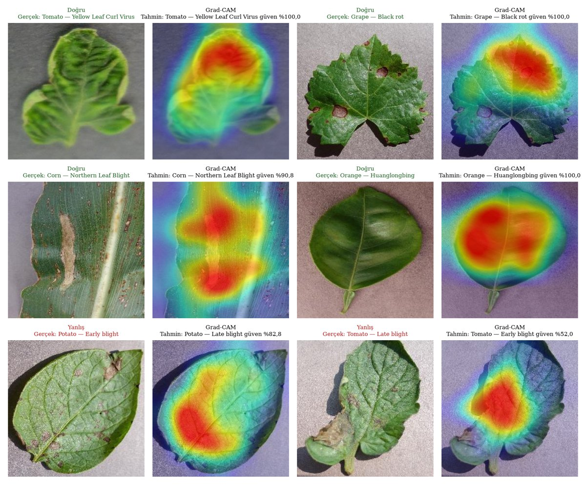

**English** | [العربية](README.ar.md) | [Türkçe](README.tr.md)

# 🌿 Plant Doctor (Bitki Doktoru)

**Deep-learning plant disease diagnosis and garden management for Android and Windows, working fully offline.**

Graduation project, Sakarya University of Applied Sciences, Faculty of Technology, Computer Engineering (2026).
Ahmad Al Sahmarany · Hasan Ifreitekh. Supervisor: Dr. Öğr. Üyesi A F M Suaib Akhter.

> This is a public showcase. The source code is kept in a private repository.

## What it does

- Take or upload a photo of a leaf, and the app identifies the **plant species and disease** in seconds (38 classes, 14 species).
- Runs **on the device**: TensorFlow Lite on Android and Keras on Windows. No internet is needed for diagnosis.
- Explains its decision with **Grad-CAM** heatmaps and suggests treatment steps.
- Manages your garden: plants, treatment plans, smart reminders, progress tracking, statistics, charts and PDF reports.
- Optional **cloud sync** between phone and PC (local-first, Supabase with row-level security).

## Results

| | |
|---|---|
| Test accuracy (PlantVillage, 8,146 images) | **96.99 %** (macro F1 0.964) |
| Real field photos (PlantDoc), before → after fine-tuning | 31.6 % → **60.0 %** class, 60.0 % → **80.4 %** species |
| Model size (INT8 TFLite) / speed | 2.8 MB, about 2.7 ms per image on a laptop CPU |

## Screenshots

### Android

| Home | Scan result | Thermal view | My garden |
|---|---|---|---|
|  |  |  |  |

### Windows

### Grad-CAM: where the model looks

## Built with

MobileNetV2 transfer learning · TensorFlow / Keras / TensorFlow Lite · OpenCV · Flutter / Dart · Python / Gradio · SQLite · Supabase · C# (Windows launcher)
