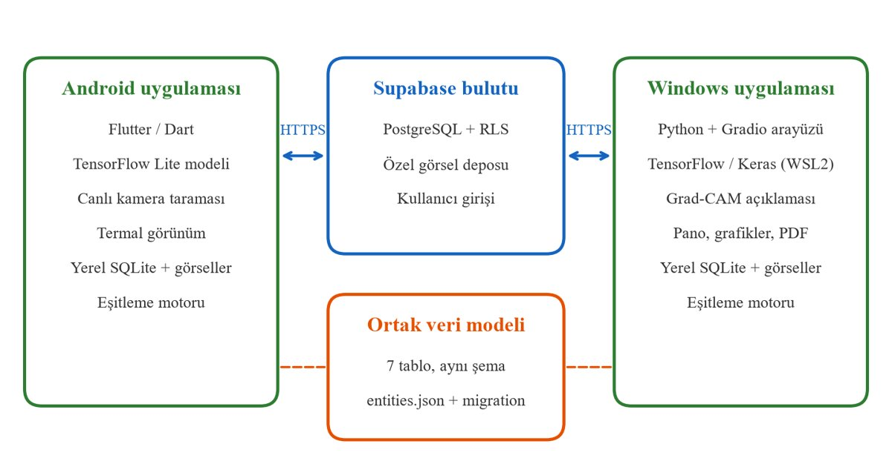
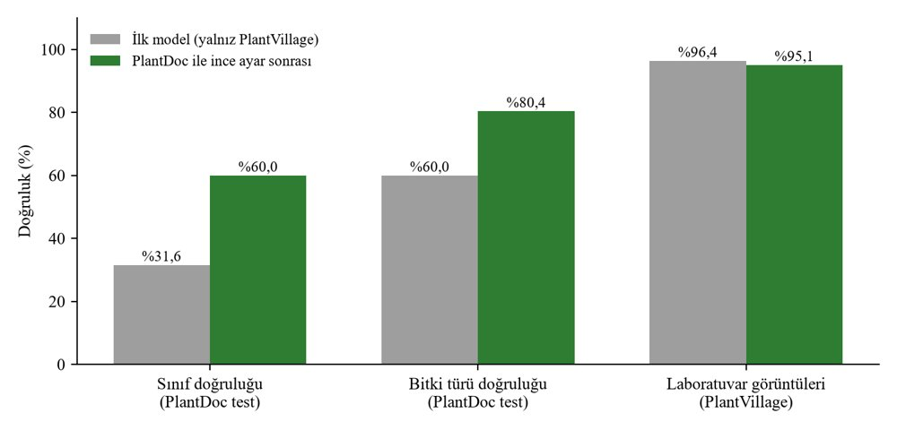
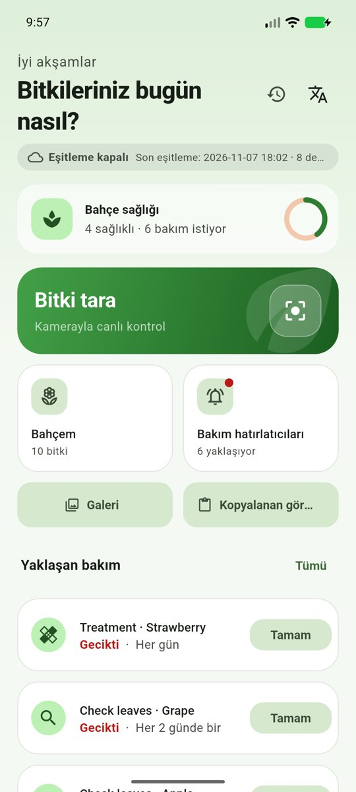
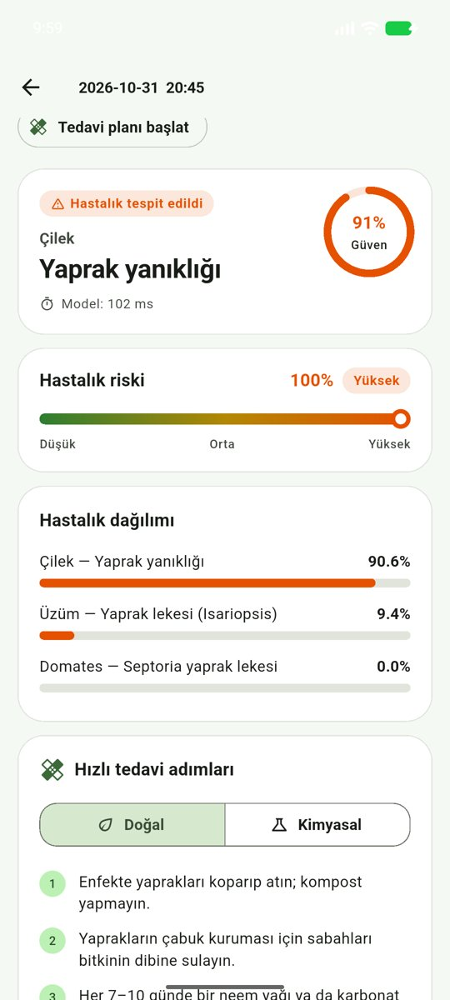
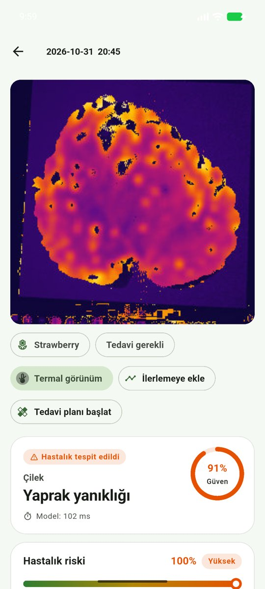
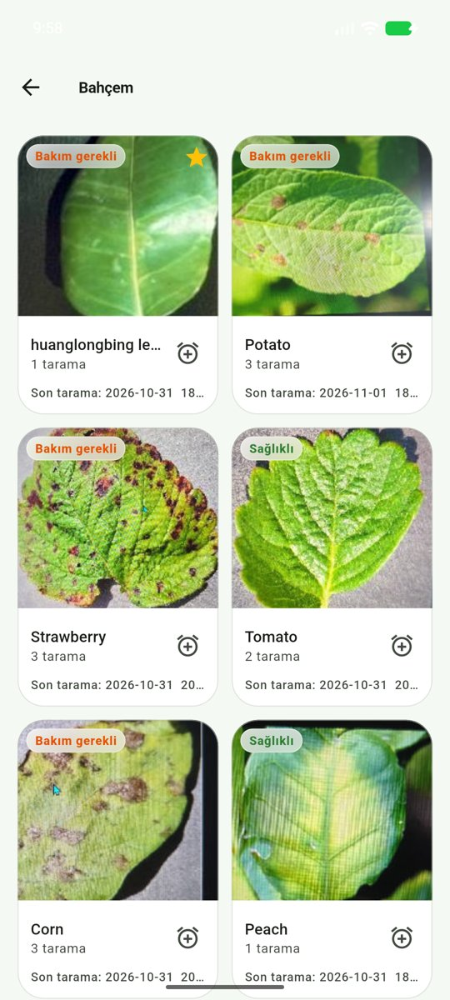
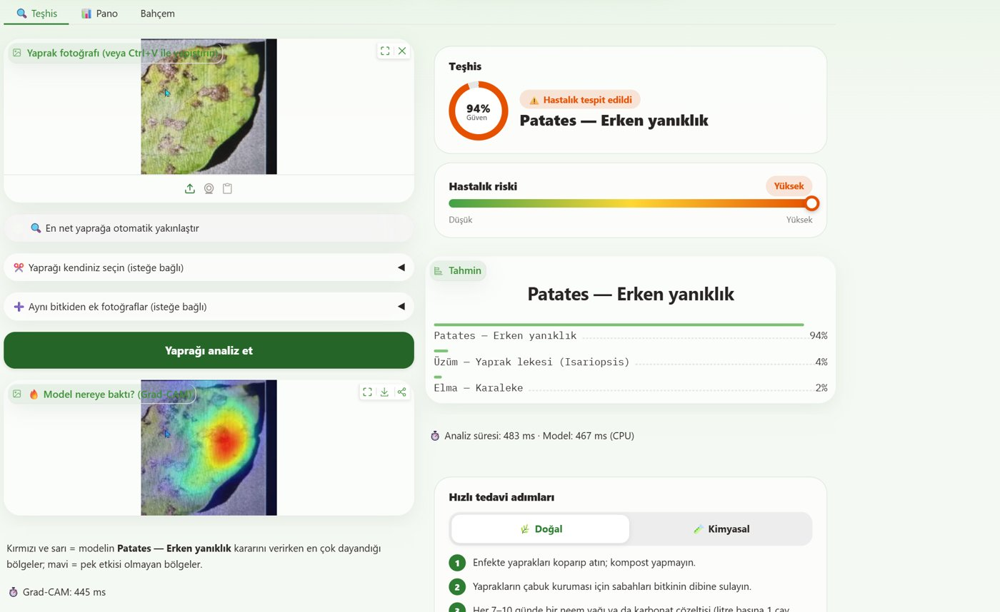
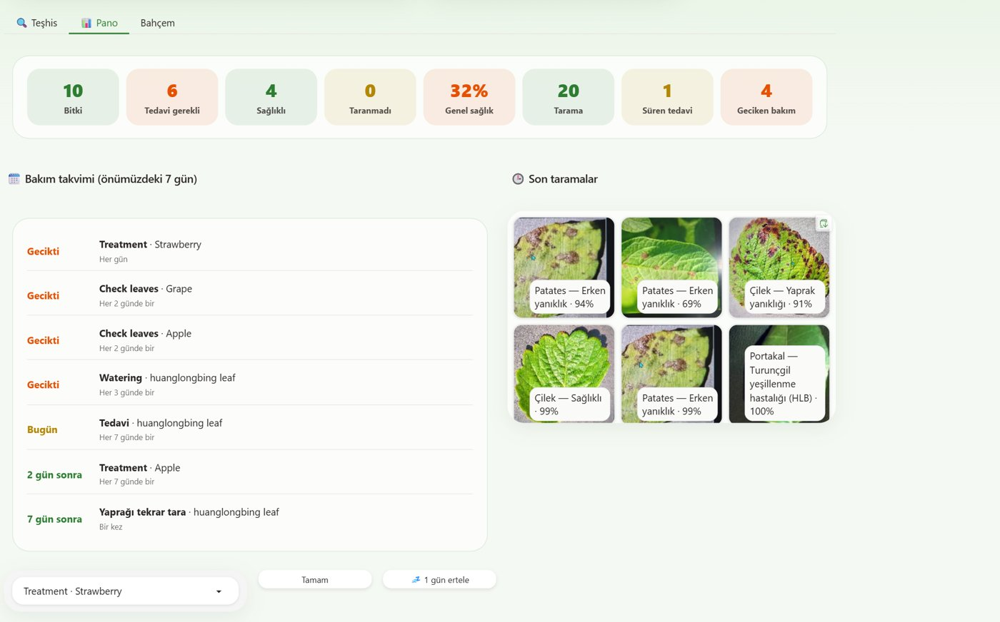
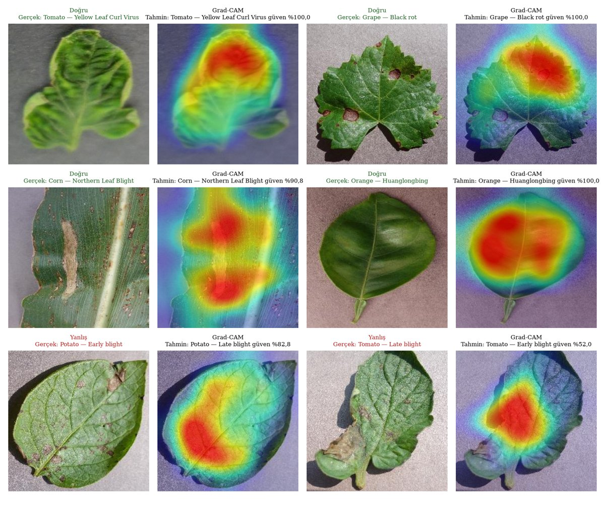

[English](README.md) | [العربية](README.ar.md) | **Türkçe**

# 🌿 Bitki Doktoru (Plant Doctor)

**Derin öğrenme tabanlı bitki hastalığı teşhisi ve bahçe yönetimi; Android ve Windows'ta, tamamen çevrim dışı çalışır.**

Bitirme çalışması, Sakarya Uygulamalı Bilimler Üniversitesi, Teknoloji Fakültesi, Bilgisayar Mühendisliği Bölümü (2026).
Ahmad Al Sahmarany · Hasan Ifreitekh. Danışman: Dr. Öğr. Üyesi A F M Suaib Akhter.

> Bu, herkese açık bir tanıtım sayfasıdır. Kaynak kod özel bir depoda tutulmaktadır.

## Ne yapar?

- Bir yaprağın fotoğrafını çekin veya yükleyin; uygulama **bitki türünü ve hastalığı** saniyeler içinde bulur (38 sınıf, 14 bitki türü).
- **Cihaz üzerinde** çalışır: Android'de TensorFlow Lite, Windows'ta Keras. Teşhis için internet gerekmez.
- Kararını **Grad-CAM** ısı haritalarıyla açıklar ve tedavi adımları önerir.
- Bahçenizi yönetir: bitkiler, tedavi planları, akıllı hatırlatıcılar, ilerleme takibi, istatistikler, grafikler ve PDF raporlar.
- Telefon ile bilgisayar arasında isteğe bağlı **bulut eşitlemesi** (yerel öncelikli, satır düzeyinde güvenlikli Supabase).

## Sonuçlar

| | |
|---|---|
| Test doğruluğu (PlantVillage, 8.146 görüntü) | **%96,99** (makro F1 0,964) |
| Gerçek tarla fotoğrafları (PlantDoc), ince ayar öncesi → sonrası | Sınıf %31,6 → **%60,0**, bitki türü %60,0 → **%80,4** |
| Model boyutu (INT8 TFLite) / hız | 2,8 MB, dizüstü işlemcide görüntü başına yaklaşık 2,7 ms |

## Ekran görüntüleri

### Android

| Ana ekran | Tarama sonucu | Termal görünüm | Bahçem |
|---|---|---|---|
|  |  |  |  |

### Windows

### Grad-CAM: model nereye bakıyor?

## Kullanılan teknolojiler

MobileNetV2 transfer öğrenme · TensorFlow / Keras / TensorFlow Lite · OpenCV · Flutter / Dart · Python / Gradio · SQLite · Supabase · C# (Windows başlatıcı)
